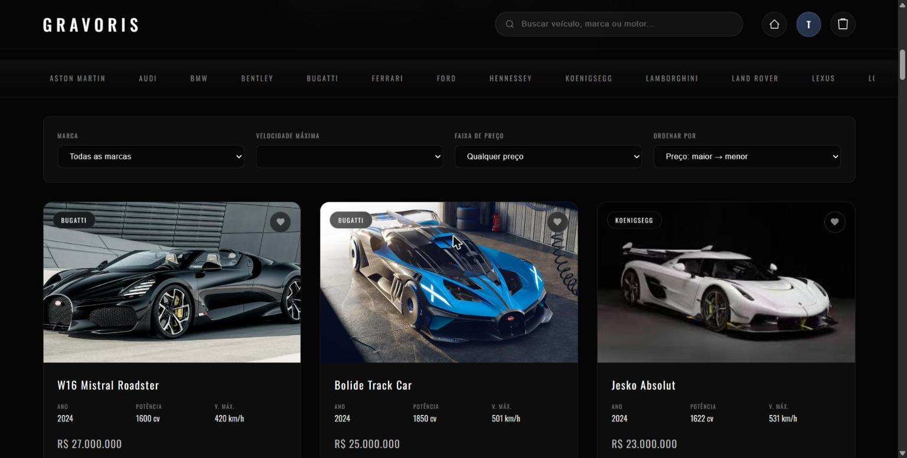
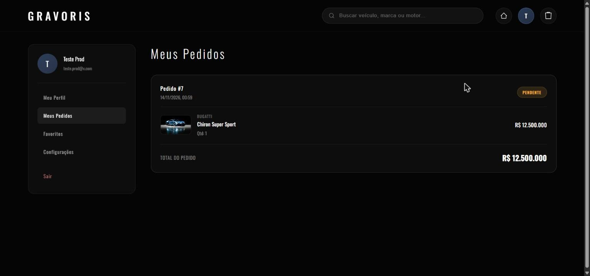
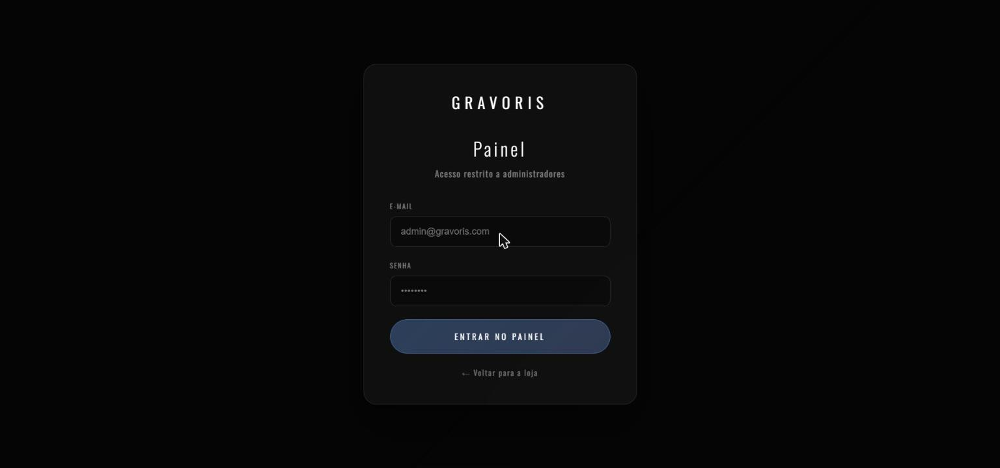
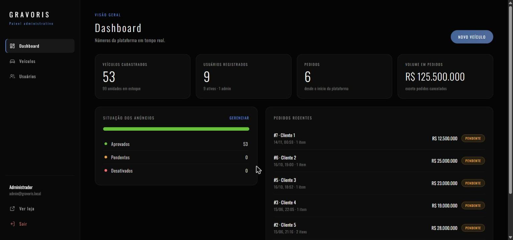
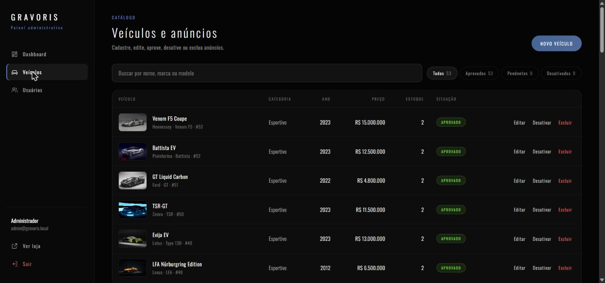
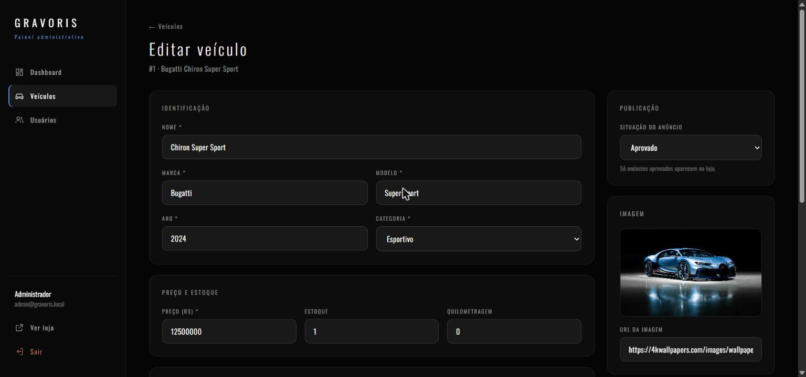
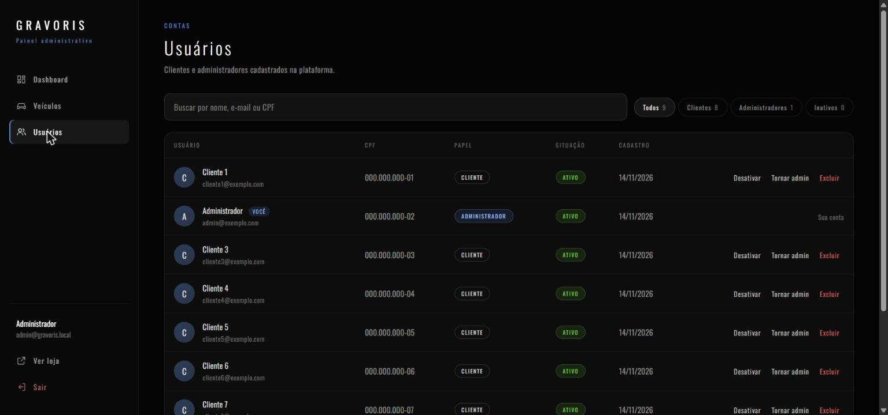

<div align="center">

# GRAVORIS

**Concessionária online de superesportivos e veículos de luxo**

Loja com catálogo, busca, favoritos, carrinho e pedidos, mais um painel administrativo para gerir anúncios e usuários.


</div>

---

## Sumário

- [Telas](#telas)
- [Funcionalidades](#funcionalidades)
- [Arquitetura e tecnologias](#arquitetura-e-tecnologias)
- [Estrutura do projeto](#estrutura-do-projeto)
- [Como rodar localmente](#como-rodar-localmente)
- [Variáveis de ambiente](#variáveis-de-ambiente)
- [Criando o primeiro administrador](#criando-o-primeiro-administrador)
- [Banco de dados (Supabase)](#banco-de-dados-supabase)
- [Migração MySQL → Supabase](#migração-mysql--supabase)
- [API](#api)
- [Segurança](#segurança)
- [Testes](#testes)
- [Deploy](#deploy)

---

## Telas

### Loja

| Catálogo com filtros | Detalhe do veículo |
|---|---|
|  |  |

| Busca | Minha conta: pedidos |
|---|---|
|  |  |

### Painel administrativo

| Login do painel | Dashboard |
|---|---|
|  |  |

| Veículos e anúncios | Edição de veículo |
|---|---|
|  |  |

| Usuários |
|---|
|  |

> Nas capturas do painel, nomes, e-mails e CPFs de clientes foram substituídos por dados de exemplo.

---

## Funcionalidades

### Loja (clientes)
- Página inicial com vídeo de fundo, sorteado a cada visita e sem áudio.
- Catálogo com filtros por marca, velocidade máxima e faixa de preço, e ordenação.
- Busca por nome, marca ou motor.
- Página de detalhe com ficha técnica: motor, potência, torque, velocidade máxima e 0–100 km/h.
- Cadastro, login com a opção "lembrar-me" e recuperação de senha com e-mail e CPF.
- Favoritos, carrinho e finalização de pedido.
- Área do cliente com perfil, pedidos, favoritos e configurações.

### Painel administrativo (`/admin`)
- **Dashboard:** veículos cadastrados, unidades em estoque, usuários, pedidos, volume vendido, situação dos anúncios e pedidos recentes.
- **Veículos e anúncios:**
  - Cadastrar, editar e excluir veículos, com busca e filtros por situação.
  - Moderação: *Pendente → Aprovado → Desativado*. Só anúncios aprovados aparecem na loja.
  - Upload de imagem para o Supabase Storage, ou URL externa, com pré-visualização.
  - Um veículo que já tem pedidos não pode ser excluído, apenas desativado.
- **Usuários:**
  - Ativar e desativar contas. A conta desativada é desconectada na hora.
  - Promover cliente a administrador e remover o acesso de administrador.
  - Excluir usuários que não têm pedidos.
  - Proteções: o admin não pode desativar, rebaixar ou excluir a própria conta, e sempre resta pelo menos um admin ativo.

---

## Arquitetura e tecnologias

```
┌────────────────────────┐   HTTPS + JWT    ┌──────────────────────────┐     JDBC     ┌──────────────────────┐
│  Frontend (Angular 21) │ ───────────────▶ │  Backend (Spring Boot 4) │ ───────────▶ │ Supabase PostgreSQL  │
│  SSR · Signals · Lazy  │                  │  Spring Security · JPA   │              │ (RLS ligado)         │
└────────────────────────┘                  └────────────┬─────────────┘              └──────────────────────┘
                                                         │ REST (service_role, só no servidor)
                                                         ▼
                                              ┌──────────────────────┐
                                              │  Supabase Storage    │
                                              │  bucket "veiculos"   │
                                              └──────────────────────┘
```

| Camada | Tecnologias |
|---|---|
| Frontend | Angular 21 (standalone components, signals, SSR), TypeScript, CSS puro |
| Backend | Java 17+, Spring Boot 4, Spring Security 7 (OAuth2 Resource Server / JWT HS256), Spring Data JPA, Bean Validation, springdoc-openapi |
| Banco | PostgreSQL no Supabase (produção) · MySQL (desenvolvimento local) · H2 (testes) |
| Arquivos | Supabase Storage |

**Perfis do Spring:**

| Perfil | Uso | Banco |
|---|---|---|
| `local` (padrão) | desenvolvimento na sua máquina | MySQL (`ddl-auto=update`) |
| `dev` | testes automatizados | H2 em memória |
| `prod` | produção | Supabase/PostgreSQL (`ddl-auto=validate`, Swagger desligado) |

---

## Estrutura do projeto

```
.
├── backend/                         # API Spring Boot
│   └── src/main/java/br/com/gravoris/
│       ├── config/                  # CORS
│       ├── controller/              # Produto, Cliente, Pedido, Admin, Health
│       ├── dto/                     # Requests/responses
│       ├── exception/               # Erros padronizados em JSON
│       ├── loader/                  # Seed do catálogo, bootstrap do admin, migrador MySQL→Supabase
│       ├── model/                   # Entidades JPA (Cliente, Produto, Pedido, ItemPedido)
│       ├── repository/
│       ├── security/                # JWT, RBAC, rate limit de login
│       └── service/
├── frontend/concessionaria/         # App Angular
│   └── src/app/
│       ├── admin/                   # Painel administrativo (lazy loaded)
│       ├── core/                    # Services, guards, interceptor, models
│       ├── pages/                   # Home, busca, detalhe, login, cadastro, carrinho, conta
│       └── shared/                  # Componentes reutilizáveis
├── supabase/migrations/             # Schema SQL do banco de produção
└── docs/screenshots/                # Imagens deste README
```

---

## Como rodar localmente

### Pré-requisitos
- **Java 17+** (o projeto também roda em JDK 21)
- **Node.js 20+** e npm
- **MySQL 8**, ou só os testes, que usam H2

### 1. Backend

```bash
cd backend
# MySQL local (perfil "local", padrão). Ajuste se o seu banco for diferente:
export MYSQL_URL="jdbc:mysql://localhost:3306/gravoris_db?createDatabaseIfNotExist=true"
export MYSQL_USER=root
export MYSQL_PASSWORD=sua_senha

./mvnw spring-boot:run          # Windows: mvnw.cmd spring-boot:run
```

A API sobe em `http://localhost:8080`. A documentação Swagger fica em `http://localhost:8080/swagger-ui.html`, fora de produção. Na primeira execução o catálogo de veículos é populado automaticamente (`SEED_CATALOG=true`).

### 2. Frontend

```bash
cd frontend/concessionaria
npm install
npm start                        # http://localhost:4200
```

Em desenvolvimento o frontend aponta para `http://localhost:8080/api` (`src/environments/environment.development.ts`).

### 3. Acessar o painel
Crie um administrador (veja abaixo) e acesse `http://localhost:4200/admin`.

---

## Variáveis de ambiente

Nenhuma credencial fica no código: tudo vem de variáveis de ambiente.

### Backend

| Variável | Obrigatória em prod | Descrição |
|---|:---:|---|
| `SPRING_PROFILES_ACTIVE` | ✅ | `prod` em produção (padrão: `local`) |
| `PORT` | | Porta HTTP (padrão `8080`) |
| `DATABASE_URL` | ✅ | `jdbc:postgresql://<host-do-pooler>:5432/postgres?sslmode=require` |
| `DATABASE_USERNAME` | ✅ | Usuário do Postgres/pooler do Supabase |
| `DATABASE_PASSWORD` | ✅ | Senha do banco |
| `DATABASE_POOL_SIZE` | | Conexões no pool (padrão `5`) |
| `JWT_SECRET` | ✅ | Segredo aleatório com **32 caracteres ou mais** |
| `JWT_EXPIRATION_MINUTES` | | Validade do token de cliente (padrão `720`) |
| `ADMIN_JWT_EXPIRATION_MINUTES` | | Validade do token de admin (padrão `120`) |
| `CORS_ALLOWED_ORIGINS` | ✅ | URLs do frontend separadas por vírgula, ex.: `https://gravoris.com.br` |
| `SUPABASE_URL` | upload | URL do projeto Supabase |
| `SUPABASE_SERVICE_ROLE_KEY` | upload | Chave *service_role*, **somente no backend** |
| `SUPABASE_STORAGE_BUCKET` | | Bucket das imagens (padrão `veiculos`) |
| `SEED_CATALOG` | | Popular o catálogo inicial (padrão `true`; desligado em prod) |
| `ADMIN_BOOTSTRAP_EMAIL` / `_PASSWORD` / `_NAME` / `_CPF` | | Criação do primeiro admin (veja abaixo) |
| `MIGRATION_ENABLED` e `MIGRATION_SOURCE_URL` / `_USER` / `_PASSWORD` | | Migração única MySQL → Supabase |
| `MYSQL_URL` / `MYSQL_USER` / `MYSQL_PASSWORD` | | Banco do perfil `local` |

Gere um `JWT_SECRET` com, por exemplo, `openssl rand -base64 48`.

### Frontend

| Variável | Uso |
|---|---|
| `API_URL` | URL pública da API (precisa ser `https://`), usada em `npm run build:prod` |

---

## Criando o primeiro administrador

Não existe cadastro público de administrador. O primeiro é criado pelo backend na inicialização, **e só enquanto não houver nenhum admin**:

```bash
export ADMIN_BOOTSTRAP_EMAIL=admin@suaempresa.com
export ADMIN_BOOTSTRAP_PASSWORD='uma-senha-forte-com-10+-caracteres'
export ADMIN_BOOTSTRAP_NAME='Administrador'
export ADMIN_BOOTSTRAP_CPF=12345678901     # 11 dígitos (só exigido se o e-mail ainda não existir)
```

- Se o e-mail já pertence a um cliente, essa conta é **promovida** a administrador.
- Depois que o admin existir, **remova essas variáveis** do ambiente.
- Novos administradores são promovidos pelo próprio painel, em **Usuários → Tornar admin**.

---

## Banco de dados (Supabase)

O schema está em [`supabase/migrations/20261114000000_schema_inicial.sql`](supabase/migrations/20261114000000_schema_inicial.sql). O script é idempotente, então pode ser executado mais de uma vez.

```
clientes ──1:N── pedidos ──1:N── item_pedido ──N:1── produtos
```

| Tabela | Principais colunas |
|---|---|
| `clientes` | `nome`, `email` (único, sem diferenciar maiúsculas), `cpf` (único), `senha` (BCrypt), `telefone`, `data_nascimento`, `role` (`CLIENTE`/`ADMINISTRADOR`), `ativo`, `criado_em` |
| `produtos` | `nome`, `marca`, `modelo`, `ano`, `preco`, `categoria`, `descricao`, `motor`, `potencia`, `torque`, `velocidade_max`, `aceleracao`, `quilometragem`, `estoque`, `imagem_url`, `status` (`PENDENTE`/`APROVADO`/`DESATIVADO`), `ativo`, `criado_em`, `atualizado_em` |
| `pedidos` | `cliente_id`, `data_pedido`, `total`, `status` |
| `item_pedido` | `pedido_id`, `produto_id`, `quantidade`, `preco_unitario` |

- **Chaves estrangeiras:**
  - Um cliente que tem pedidos não pode ser apagado (`RESTRICT`).
  - Os itens são apagados junto com o pedido (`CASCADE`).
  - Um produto vendido não pode ser apagado (`RESTRICT`).
- **Constraints:** `CHECK` para preço, estoque e quantidade não negativos, e para os valores válidos de `role` e `status`.
- **RLS:** ligado em todas as tabelas e sem permissões para `anon` e `authenticated`. Os dados só são acessíveis pelo backend, nunca direto pelo navegador.
- **Storage:** o bucket público `veiculos` aceita até 5 MB, apenas imagens. O upload é feito somente pelo backend.

### Passo a passo no painel do Supabase
1. Crie o projeto e anote a senha do banco.
2. No **SQL Editor**, cole e execute o arquivo de migração.
3. Em **Project Settings → Database → Connection string**, copie a string do **Session pooler**, que serve para `DATABASE_URL`, `DATABASE_USERNAME` e `DATABASE_PASSWORD`.
4. Em **Project Settings → API**, copie a **Project URL** (`SUPABASE_URL`) e a chave **service_role** (`SUPABASE_SERVICE_ROLE_KEY`).
5. Confira em **Storage** se o bucket `veiculos` foi criado.

---

## Migração MySQL → Supabase

O backend traz um migrador de execução única. Ele copia clientes, produtos, pedidos e itens **preservando os IDs** e funciona assim:
- Tudo roda em uma única transação.
- Ao final, ajusta as sequences e confere contagens e registros órfãos.
- Se o banco de destino já tiver dados, ele se recusa a rodar.
- O MySQL é só lido, nunca alterado.

```bash
# Destino (Supabase) — mesmas variáveis de produção
export SPRING_PROFILES_ACTIVE=prod
export DATABASE_URL=... DATABASE_USERNAME=... DATABASE_PASSWORD=... JWT_SECRET=...

# Origem (MySQL)
export MIGRATION_ENABLED=true
export MIGRATION_SOURCE_URL="jdbc:mysql://localhost:3306/gravoris_db"
export MIGRATION_SOURCE_USER=root
export MIGRATION_SOURCE_PASSWORD=sua_senha

cd backend && ./mvnw -q -DskipTests package
java -jar target/backend-0.0.1-SNAPSHOT.jar
```

O processo encerra sozinho depois de migrar e mostra no log o resumo das contagens. **Só desative o MySQL depois de conferir os dados no Supabase.**

---

## API

Base: `/api`. As rotas protegidas exigem o cabeçalho `Authorization: Bearer <token>`.

### Pública
| Método | Rota | Descrição |
|---|---|---|
| GET | `/health` | Health check |
| GET | `/produtos/vitrine` | Veículos aprovados |
| GET | `/produtos/busca?q=` | Busca por nome, marca ou motor |
| GET | `/produtos/{id}` | Detalhe (só anúncios aprovados) |
| POST | `/clientes` | Cadastro (sempre como `CLIENTE`) |
| POST | `/clientes/login` | Login do cliente |
| POST | `/clientes/redefinir-senha` | Redefinição com e-mail e CPF |

### Cliente autenticado
| Método | Rota | Descrição |
|---|---|---|
| GET / PUT | `/clientes/{id}` | Ver e editar o próprio perfil |
| POST | `/pedidos` | Criar pedido |
| GET | `/pedidos/cliente/{clienteId}` | Listar os próprios pedidos |

### Administrador (`/api/admin`)
| Método | Rota | Descrição |
|---|---|---|
| POST | `/auth/login` | Login do painel |
| GET | `/auth/me` | Sessão atual |
| GET | `/dashboard` | Indicadores |
| GET / POST | `/veiculos` | Listar (`?q=&status=`) e criar |
| GET / PUT / DELETE | `/veiculos/{id}` | Ver, editar e excluir |
| PATCH | `/veiculos/{id}/status` | Aprovar, deixar pendente ou desativar |
| POST | `/uploads/imagem` | Upload de imagem (multipart, campo `file`) |
| GET | `/uploads/status` | Diz se o Storage está configurado |
| GET | `/usuarios` | Listar (`?q=`) |
| PATCH | `/usuarios/{id}/status` | Ativar ou desativar |
| PATCH | `/usuarios/{id}/role` | Promover ou rebaixar |
| DELETE | `/usuarios/{id}` | Excluir |

Os erros seguem um formato único: `{ "error": "mensagem", "status": 400, "timestamp": "..." }`.

---

## Segurança

- **Autenticação:** JWT assinado (HS256) com emissor validado e expiração. Sessões de cliente e de admin são separadas, e a de admin é mais curta.
- **Autorização (RBAC):**
  - As regras são aplicadas **no servidor**.
  - O papel e o status da conta são reconferidos no banco a cada requisição: um admin rebaixado ou uma conta desativada perde o acesso na hora.
  - Cada cliente só acessa os próprios dados e pedidos.
- **Senhas:** guardadas com BCrypt. O login é bloqueado por 15 minutos depois de 5 tentativas erradas (HTTP 429).
- **Recuperação de senha:** exige e-mail e CPF e responde com uma mensagem genérica. Contas de administrador não podem ser redefinidas por esse fluxo.
- **Uploads:** o servidor valida o tipo real do arquivo (assinatura do arquivo) e o limite de 5 MB.
- **Configuração:**
  - CORS restrito às origens configuradas.
  - Swagger desligado em produção, e as respostas de erro não expõem stack traces.
  - Nenhuma chave privada no frontend: o build de produção não contém credenciais nem `localhost`.

---

## Testes

```bash
cd backend
./mvnw test
```

Os testes de integração (H2, perfil `dev`) cobrem:
- Cadastro e login.
- Permissões: 401, 403 e acesso a dados de terceiros.
- Pedidos.
- RBAC do painel.
- Ciclo de vida de anúncios.
- Gestão de usuários.
- Upload sem Storage configurado.

```bash
cd frontend/concessionaria
npm run build                    # build de produção
```

---

## Deploy

1. **Banco:** execute a migração SQL no Supabase e, se precisar, migre os dados do MySQL.
2. **Backend:** qualquer serviço que rode Java, como Render, Railway, Fly.io ou uma VM.
   ```bash
   cd backend && ./mvnw -DskipTests package
   java -jar target/backend-0.0.1-SNAPSHOT.jar   # com SPRING_PROFILES_ACTIVE=prod e as variáveis acima
   ```
   - A porta vem de `PORT`.
   - Atrás de proxy, os cabeçalhos `X-Forwarded-*` já são respeitados.
   - Use `GET /api/health` como health check.
3. **Frontend:**
   ```bash
   cd frontend/concessionaria
   API_URL=https://sua-api.com/api npm run build:prod
   ```
   - **Com SSR:** rode `node dist/concessionaria/server/server.mjs`.
   - **Só estático:** publique `dist/concessionaria/browser` em Netlify, Vercel ou outro host, com fallback de SPA para `index.html`.
4. **CORS:** coloque a URL final do site em `CORS_ALLOWED_ORIGINS`.
5. **Primeiro admin:** suba uma vez com as variáveis `ADMIN_BOOTSTRAP_*` e depois remova-as.
